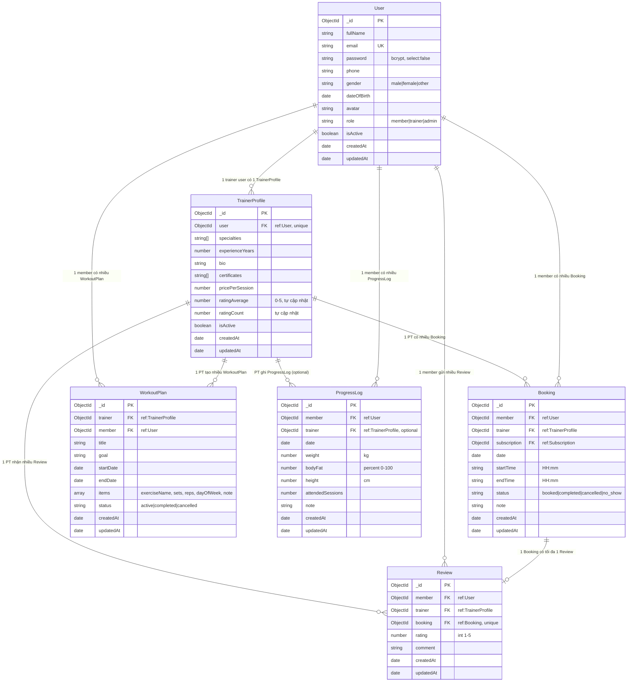

# ERD & Từ điển Dữ liệu — Phần của Anh (anhnthe194418)

> Mô tả các collection MongoDB do Anh phụ trách: **User, TrainerProfile, WorkoutPlan, ProgressLog, Review**  
> Collection **Booking** do Hiếu phụ trách nhưng Anh dùng — ghi chú cardinality.

---

## ERD Sơ đồ quan hệ (Mermaid)

---

## Từ điển Dữ liệu

### Collection: `users`

| Field | Type | Required | Unique | Mô tả |
|-------|------|----------|--------|-------|
| `_id` | ObjectId | ✅ | ✅ | Primary key, auto |
| `fullName` | String | ✅ | ❌ | Họ tên, trim |
| `email` | String | ✅ | ✅ | Lowercase, trim; dùng để đăng nhập |
| `password` | String | ✅ | ❌ | Bcrypt hash; `select: false` — không trả về client |
| `phone` | String | ❌ | ❌ | Số điện thoại, trim |
| `gender` | String | ❌ | ❌ | `male` \| `female` \| `other` |
| `dateOfBirth` | Date | ❌ | ❌ | Ngày sinh |
| `avatar` | String | ❌ | ❌ | URL avatar |
| `role` | String | ✅ | ❌ | `member` \| `trainer` \| `admin`; mặc định `member` |
| `isActive` | Boolean | ✅ | ❌ | `true` mặc định; `false` = bị khóa |
| `createdAt` | Date | auto | ❌ | timestamps |
| `updatedAt` | Date | auto | ❌ | timestamps |

**Index:** `{ email: 1 }` unique

---

### Collection: `trainerprofiles`

| Field | Type | Required | Mô tả |
|-------|------|----------|-------|
| `_id` | ObjectId | ✅ | Primary key |
| `user` | ObjectId (ref: User) | ✅ unique | FK đến User có role trainer |
| `specialties` | [String] | ❌ | Mảng chuyên môn: ["Gym", "Yoga"] |
| `experienceYears` | Number | ❌ | ≥ 0, số năm kinh nghiệm |
| `bio` | String | ❌ | Giới thiệu bản thân |
| `certificates` | [String] | ❌ | Danh sách chứng chỉ |
| `pricePerSession` | Number | ✅ | ≥ 0, VNĐ |
| `ratingAverage` | Number | ❌ | 0–5, làm tròn 1 chữ số; tự cập nhật qua `Review.calcAverageRatings()` |
| `ratingCount` | Number | ❌ | Số lượng review; tự cập nhật |
| `isActive` | Boolean | ❌ | Mặc định `true`; Admin quản lý |

**Index:** `{ user: 1 }` unique

---

### Collection: `bookings` *(Hiếu phụ trách schema, Anh dùng)*

| Field | Type | Required | Mô tả |
|-------|------|----------|-------|
| `member` | ObjectId (ref: User) | ✅ | Member đặt lịch |
| `trainer` | ObjectId (ref: TrainerProfile) | ✅ | PT được đặt |
| `subscription` | ObjectId (ref: Subscription) | ✅ | Gói tập dùng |
| `date` | Date | ✅ | Ngày buổi tập |
| `startTime` | String | ✅ | `HH:mm`, ví dụ `09:00` |
| `endTime` | String | ✅ | `HH:mm`, ví dụ `10:00` |
| `status` | String | ✅ | `booked` \| `completed` \| `cancelled` \| `no_show` |
| `note` | String | ❌ | Ghi chú |

**Index:** `{ trainer, date, startTime }` unique — chống trùng lịch PT

---

### Collection: `workoutplans`

| Field | Type | Required | Mô tả |
|-------|------|----------|-------|
| `_id` | ObjectId | ✅ | Primary key |
| `trainer` | ObjectId (ref: TrainerProfile) | ✅ | PT tạo giáo án |
| `member` | ObjectId (ref: User) | ✅ | Học viên |
| `title` | String | ✅ | Tên giáo án |
| `goal` | String | ❌ | Mục tiêu |
| `startDate` | Date | ✅ | Ngày bắt đầu |
| `endDate` | Date | ✅ | Ngày kết thúc |
| `items` | [Object] | ❌ | Danh sách bài tập (xem bên dưới) |
| `status` | String | ❌ | `active` \| `completed` \| `cancelled`; mặc định `active` |

**items[] schema:**
| Sub-field | Type | Required |
|-----------|------|----------|
| `dayOfWeek` | String | ❌ | Thứ trong tuần (ví dụ: `Monday`) |
| `exerciseName` | String | ✅ | Tên bài tập |
| `sets` | Number | ✅ | Số hiệp |
| `reps` | String | ✅ | Số lần / thời gian (ví dụ: `8-12`, `60s`) |
| `note` | String | ❌ | Ghi chú thêm |

---

### Collection: `progresslogs`

| Field | Type | Required | Mô tả |
|-------|------|----------|-------|
| `_id` | ObjectId | ✅ | Primary key |
| `member` | ObjectId (ref: User) | ✅ | Học viên |
| `trainer` | ObjectId (ref: TrainerProfile) | ❌ | PT ghi (nếu có) |
| `date` | Date | ✅ | Ngày ghi nhận; mặc định `Date.now` |
| `weight` | Number | ❌ | Cân nặng (kg), ≥ 0 |
| `bodyFat` | Number | ❌ | Tỷ lệ mỡ cơ thể (%), 0–100 |
| `height` | Number | ❌ | Chiều cao (cm), ≥ 0 |
| `attendedSessions` | Number | ❌ | Số buổi tập hoàn thành, ≥ 0; mặc định 0 |
| `note` | String | ❌ | Ghi chú của PT |

**Upsert key:** `{ member, trainer, date (cùng ngày) }` — idempotent, tránh tạo trùng log trong ngày.

---

### Collection: `reviews`

| Field | Type | Required | Mô tả |
|-------|------|----------|-------|
| `_id` | ObjectId | ✅ | Primary key |
| `member` | ObjectId (ref: User) | ✅ | Member gửi đánh giá |
| `trainer` | ObjectId (ref: TrainerProfile) | ✅ | PT được đánh giá |
| `booking` | ObjectId (ref: Booking) | ✅ unique | FK đến booking đã completed; unique → mỗi booking chỉ 1 review |
| `rating` | Number | ✅ | Số nguyên 1–5 |
| `comment` | String | ❌ | Nội dung nhận xét |
| `createdAt` | Date | auto | timestamps |

**Index:** `{ booking: 1 }` unique  
**Static method:** `Review.calcAverageRatings(trainerId)` — tự cập nhật `TrainerProfile.ratingAverage` và `ratingCount` sau mỗi save/delete.

---

## Cardinality Summary

| Quan hệ | Loại |
|---------|------|
| User → TrainerProfile | 1:0..1 (chỉ trainer user) |
| User (member) → Booking | 1:N |
| TrainerProfile → Booking | 1:N |
| User (member) → WorkoutPlan | 1:N |
| TrainerProfile → WorkoutPlan | 1:N |
| User (member) → ProgressLog | 1:N |
| TrainerProfile → ProgressLog | 1:N (optional) |
| Booking → Review | 1:0..1 (unique) |
| User (member) → Review | 1:N |
| TrainerProfile → Review | 1:N |

---

## Index Summary

| Collection | Index | Type |
|-----------|-------|------|
| `users` | `{ email: 1 }` | unique |
| `trainerprofiles` | `{ user: 1 }` | unique |
| `bookings` | `{ trainer, date, startTime }` | unique |
| `reviews` | `{ booking: 1 }` | unique |
