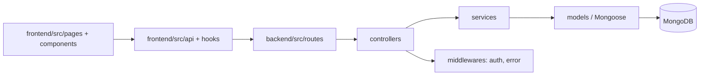
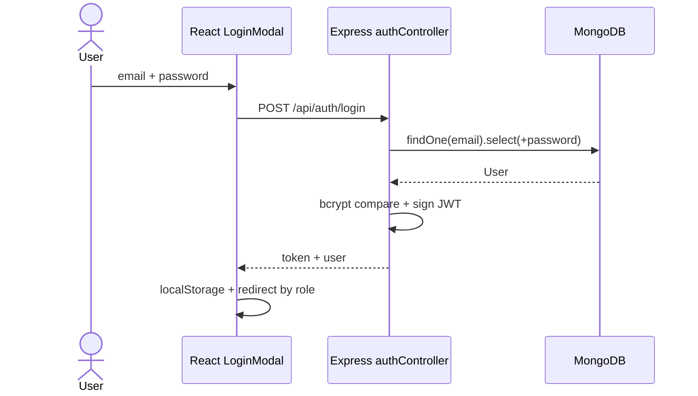
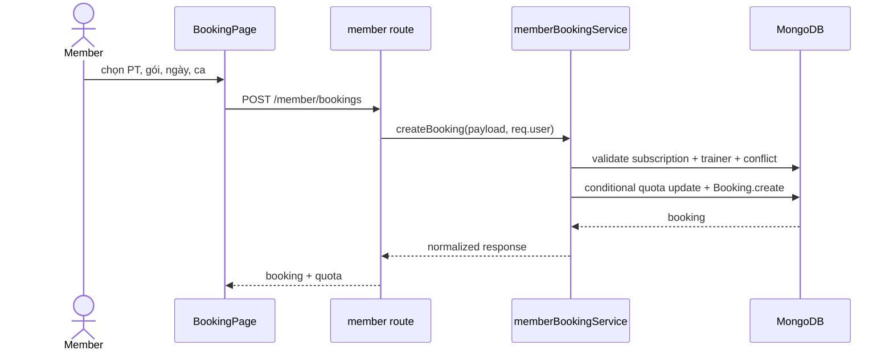

# FitManager Software Design Specification

**Phiên bản:** 3.0 · **Ngày:** 06/11/2026 · **Architecture:** MVC REST

## I. Overview

### 1. Code packages



| Package | Description |
| --- | --- |
| `frontend/src/pages` | Màn Member, Trainer, Admin và profile. |
| `frontend/src/components` | Header, Sidebar, modal, dashboard primitives và Admin UI. |
| `frontend/src/api` | API client bearer token và resource endpoints. |
| `frontend/src/hooks` | Auth restore, resource loading, schedule/progress state. |
| `backend/src/routes` | Route theo role và resource. |
| `backend/src/controllers` | Nhận request, validate input, trả response. |
| `backend/src/services` | Nghiệp vụ quota, booking state, review, progress, admin. |
| `backend/src/models` | Mongoose schema, index, validation, optimistic concurrency. |
| `backend/src/middlewares` | Auth JWT và error normalization. |

Tên file dùng PascalCase cho model/component; camelCase cho service/controller/hook; route dùng kebab hoặc resource plural. Response chuẩn `{ success, message, data }`.

### 2. Database design

**Database schema:** [database.svg](diagram/database.svg) · **ERD:** [erd.svg](diagram/erd.svg).

| Collection | Key fields | Index / rule |
| --- | --- | --- |
| `users` | fullName, email, password, role, isActive | unique email; role + active + createdAt |
| `trainerprofiles` | user, specialties, bio, ratingAverage, ratingCount | one profile per trainer |
| `membershippackages` | name, price, durationDays, includesPT, sessionLimit, isActive | active catalog |
| `subscriptions` | member, package, snapshot fields, start/end, payment/status, reservedSessions | member/status/endDate; payment/paidAt |
| `bookings` | member, trainer, subscription, date, start/end, status, quotaReserved | partial unique trainer/date/start and member/date/start |
| `workoutplans` | trainer, member, title, date range, items, status, version | trainer/member/status/date |
| `progresslogs` | member, trainer, booking, measurements, clientRequestId | scoped idempotency key |
| `reviews` | booking, member, trainer, rating, comment | unique booking |

MongoDB ObjectId refs are application relationships, not SQL foreign keys. WorkoutPlan.items is embedded data. Database backup/restore and quota reconciliation are maintenance operations documented in `docs/06-mongodb-optimization.md`.

## II. Code designs

### 1. Authentication

#### Class specifications

| Class/module | Method | Responsibility |
| --- | --- | --- |
| `authController` | `register` | Validate public payload, force member role, hash password via User pre-save, return JWT. |
| `authController` | `login` | Find email with password, compare bcrypt, reject inactive user, return JWT/user. |
| `auth` middleware | `protect` | Verify HS256 JWT, load User, attach `req.user`. |
| `useAuth` | `restoreSession` | Call `/auth/me`, remove invalid token and restore UI state. |

#### Sequence



#### Database queries

```js
User.findOne({ email: normalizedEmail }).select('+password');
User.findById(req.user._id); // /auth/me
```

### 2. Subscription and booking

#### Class specifications

| Module | Method | Responsibility |
| --- | --- | --- |
| `memberBookingService` | `createBooking` | Check member, trainer, active paid subscription, quota and conflicting slots. |
| `bookingStatusService` | `setBookingStatus` | Enforce ownership, time boundary, terminal status and quota adjustment. |
| `adminService` | `confirmPayment` | Mark paid, set paidAt, activate subscription idempotently. |
| `bookingApi` | `create/cancel` | Serialize UI input and send bearer request. |

#### Sequence



#### Database queries

```js
Subscription.findOne({ _id: subscriptionId, member: userId, status: 'active', paymentStatus: 'paid' });
Booking.findOne({ trainer: trainerId, date, startTime, status: { $in: ['booked', 'completed', 'no_show'] } });
Subscription.updateOne({ _id: subscriptionId, reservedSessions: { $lt: sessionLimit } }, { $inc: { reservedSessions: 1 } });
```

### 3. Trainer progress and review

PT tạo WorkoutPlan/ProgressLog theo quan hệ booking; Member đọc resource đã scope. Review chỉ được tạo bởi member sở hữu Booking completed đã kết thúc và có unique booking index. `expectedVersion` bảo vệ sửa giáo án khỏi bản cũ.

### 4. Admin reporting

Admin routes gọi `adminService`, dùng aggregation `$match` paid + `paidAt`, `$group` theo tháng và trả dữ liệu cho revenue dashboard. User/package lock dùng `isActive=false` để không xóa lịch sử.

## III. Non-functional design

- **Security:** JWT bearer, bcrypt, role middleware, whitelist profile fields, không log secret/password.
- **Consistency:** optimistic concurrency cho User/Subscription/WorkoutPlan; unique indexes chống booking/review trùng.
- **Responsive UI:** sidebar chuyển thành horizontal nav dưới 768px; cards stack dưới 680px; target touch tối thiểu 44px.
- **Observability:** health endpoint, normalized error handler, `ConnectionStatus`, loading/error/empty state.
- **Known limits:** chưa có payment gateway, realtime, rate limit, JWT denylist, scheduler expire subscription hay audit log bất biến.
