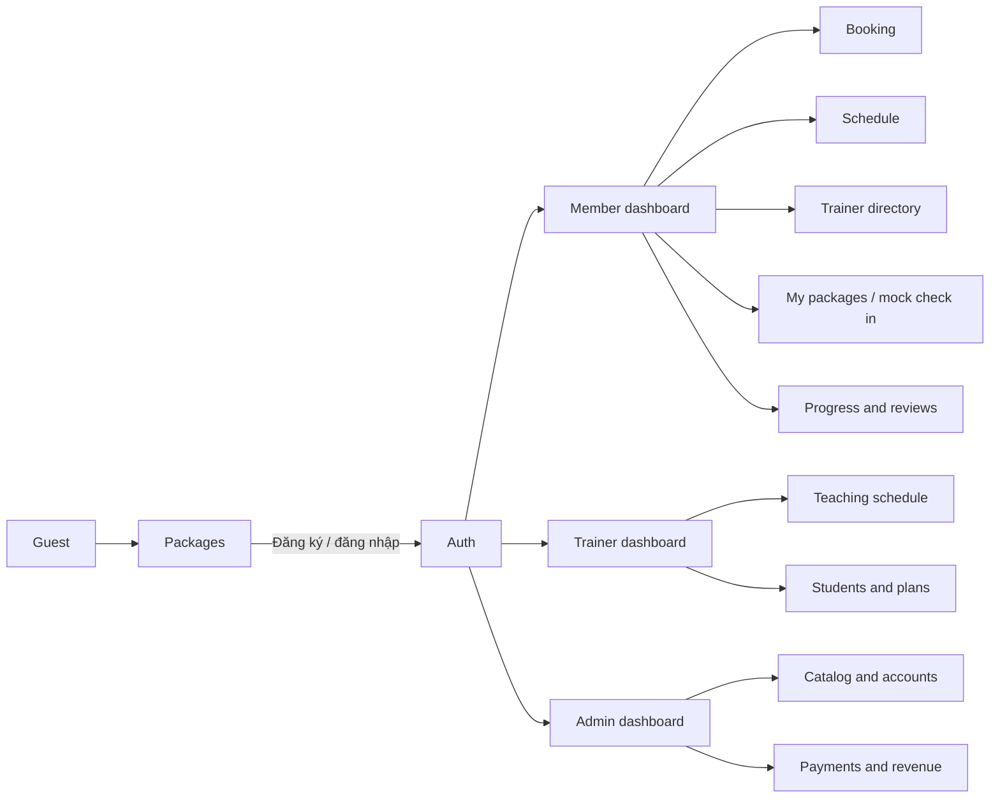

# FitManager Software Requirement Specification

**Phiên bản:** 3.0 · **Ngày:** 06/11/2026 · **Mô hình:** MVC · **Ngôn ngữ:** tiếng Việt

## Record of changes

| Ngày | Người phụ trách | Thay đổi |
| --- | --- | --- |
| 06/11/2026 | Nhóm FitManager | Hợp nhất các nhánh thành viên, chuẩn hóa UI dashboard, bổ sung QR check in mô phỏng và bộ sơ đồ SRS |

## I. Overview

### 1. Introduction

FitManager là website quản lý phòng tập và huấn luyện viên cho một cơ sở gym. Hệ thống thay thế việc ghi lịch, quản lý gói và theo dõi học viên bằng quy trình web có phân quyền. Chủ phòng tập quản lý PT, hội viên, gói tháng/quý/năm, thanh toán xác nhận thủ công và báo cáo. PT quản lý lịch dạy, học viên, giáo án và tiến độ. Member đăng ký gói, đặt lịch PT, xem tiến độ và gửi URL bằng chứng sau bài tập.

Sản phẩm chạy với React/Vite ở trình duyệt, Express REST API theo MVC ở backend và MongoDB. Tiền tệ là VND; lịch nghiệp vụ dùng Asia/Ho_Chi_Minh và Date lưu UTC. Phiên bản hiện tại không kết nối cổng thanh toán, không dùng QR để thu tiền thật và không cho khách tự đặt role PT/admin.

**Context diagram:** [context.svg](diagram/context.svg). **Actors:** Guest, Member, Trainer/PT, Admin. **External dependency:** MongoDB qua backend; không có payment gateway ở MVP.

### 2. System Functions

#### a. Screen flow

#### b. Screen details

| # | Feature | Screen | Description |
| --- | --- | --- | --- |
| 1 | Public catalog | Packages | Xem gói đang hoạt động, giá, hạn dùng, quota và quyền lợi PT. |
| 2 | Member | Dashboard | Thống kê gói hiệu lực, lịch sắp tới, tiến độ và ví nạp mô phỏng. |
| 3 | Member | Trainer directory | Tìm theo tên/chuyên môn và chọn PT để đặt lịch. |
| 4 | Member | Booking | Chọn PT, ngày và ca 60 phút; server kiểm tra gói, quota và xung đột. |
| 5 | Member | My packages | Xem pending/active/expired, thanh toán và ngày hiệu lực. |
| 6 | Member | Mock check in | Xem payload check-in cục bộ của gói active; chưa có quét hoặc ghi nhận lượt vào thật. |
| 7 | Trainer | Dashboard | Số học viên, buổi sắp dạy, rating và lịch gần nhất. |
| 8 | Trainer | Students and plans | Tìm học viên, tạo/sửa giáo án và ghi ProgressLog. |
| 9 | Admin | Management portal | Quản lý gói, PT, member, lịch, thanh toán và doanh thu. |

#### c. User authorization

| Screen / activity | Guest | Member | Trainer | Admin |
| --- | --- | --- | --- | --- |
| Xem gói hoạt động | X | X | X | X |
| Đăng ký Member | X |  |  |  |
| Đặt/hủy lịch của mình |  | X |  |  |
| Xem danh mục PT |  | X |  | X |
| Xem lịch PT liên quan |  |  | X | X |
| Chốt completed/no-show |  |  | X của mình | X |
| Tạo/sửa giáo án, ghi tiến độ |  |  | X học viên liên quan |  |
| Gửi review booking completed |  | X |  |  |
| Quản lý gói, tài khoản, thanh toán |  |  |  | X |

Backend luôn lấy role từ User trong database; ẩn menu chỉ là UX, không phải lớp bảo vệ.

#### d. Non-screen functions

| Function | Mô tả |
| --- | --- |
| JWT auth middleware | Xác minh token, tải User, kiểm tra isActive và role. |
| Booking quota service | Giữ quota bằng cập nhật có điều kiện; hủy lịch hoàn quota. |
| Booking status service | Chặn chuyển trạng thái sai, chỉ cho PT/Admin chốt sau giờ kết thúc. |
| Revenue aggregation | Tổng hợp Subscription paid theo paidAt cho Admin. |
| Database archive | Backup/restore BSON có xác nhận và kiểm tra phục hồi. |

### 3. Entity Relationship Diagram

**ERD:** [erd.svg](diagram/erd.svg) · **Database schema:** [database.svg](diagram/database.svg).

| Entity | Description |
| --- | --- |
| User | Tài khoản và role member/trainer/admin. |
| TrainerProfile | Chuyên môn, bio, rating của User trainer. |
| MembershipPackage | Gói tập, giá, duration, includesPT, sessionLimit. |
| Subscription | Snapshot gói của member, ngày hiệu lực, payment/status và quota. |
| Booking | Một ca PT 60 phút, member, trainer, subscription và trạng thái. |
| WorkoutPlan | Giáo án của PT cho member, items nhúng và version. |
| ProgressLog | Chỉ số thể trạng do PT ghi nhận. |
| Review | Rating/comment duy nhất cho booking completed. |
| WorkoutSubmission | URL bằng chứng http/https gắn với bài tập trong giáo án và ngày hoàn thành. |

## II. Functional Requirements

### 1. Membership and payment

**Trigger:** Member mở Packages và chọn Đăng ký. **Normal flow:** chọn ngày bắt đầu → POST `/member/subscriptions` → server snapshot giá/quyền lợi → trạng thái pending/unpaid → Admin xác nhận → paid/active. **Validation:** package active, start date hợp lệ, amount nguyên không âm; không tin amount từ client. Lỗi trả 400/401/409 và không tạo khoản thu lặp.

### 2. Booking PT

**Trigger:** Member chọn PT và ca. **Normal flow:** UI gửi trainerId, subscriptionId, date, startTime → server kiểm tra ownership, gói paid/active, includesPT, quota, PT active và slot trùng → lưu Booking. Ca chuẩn là 08:00–21:00, mỗi ca 60 phút. Hủy trước giờ bắt đầu chỉ dành đúng member và hoàn quota.

### 3. Trainer operations

PT xem lịch của mình, tìm member liên quan, tạo/sửa WorkoutPlan với expectedVersion, ghi ProgressLog và chốt completed/no_show sau giờ kết thúc. Member chỉ xem giáo án/log của chính mình. Backend từ chối member không có quan hệ lịch hợp lệ.

### 4. QR check in mô phỏng

API `GET /member/check-in-qr` trả payload JSON mô phỏng khi có gói active/paid. Giao diện hiển thị payload cục bộ; không gọi dịch vụ QR bên ngoài, không đại diện giao dịch ngân hàng, chưa có endpoint quét hoặc ghi nhận lượt vào.

### 5. Admin management

Admin tạo/sửa/khóa package, tạo/cập nhật/khóa User trainer/member, xem/lọc Booking, xác nhận Subscription và xem revenue. Khóa là soft lock để giữ lịch sử. Mọi API admin yêu cầu `role=admin`.

## III. Acceptance criteria

- `frontend`: `npm run build` và `npm run lint` thành công.
- Member không thể tự đặt role trainer/admin khi đăng ký.
- Booking trùng slot, thiếu quota, gói hết hạn hoặc PT không hoạt động bị từ chối.
- Admin xác nhận thanh toán nhiều lần không tạo doanh thu trùng.
- Trang chính có loading, error, empty và responsive layout ở mobile.
- Các diagram trong `docs/diagram` mở được bằng draw.io và khớp API/schema hiện có.

## Daily workout proof
Member selects an exercise from a PT plan and submits an http/https URL to an image or video. The URL is stored in WorkoutSubmission with the member, plan, exercise and completion date.
