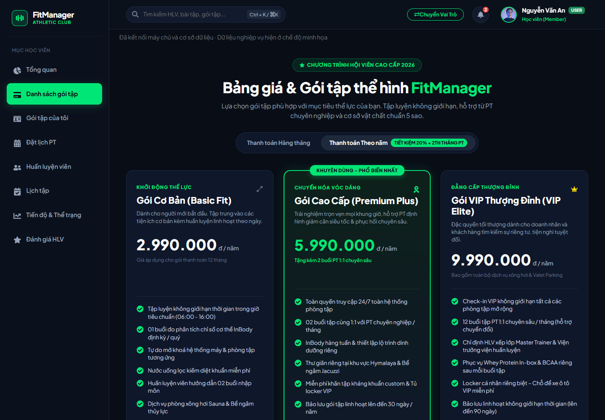

# Biên bản xác minh — 11/10/2026

**Full frontend quality 23/10/2026:** đã sửa 39 lỗi lint nền; npm run lint toàn frontend và production build đạt local. Browser UAT bổ sung profile, chống phản hồi lọc cũ ghi đè và reset/switch bốn modal dùng chung đạt. CI frontend được nâng từ lint:admin lên full lint; kết quả CI của phần bổ sung cần xác nhận sau push. Xem [chi tiết](11-frontend-quality.md).

**Browser regression 23/10/2026:** [CI run 39865513485](https://github.com/Huy-Haru/ProjectSDN/actions/runs/39865513485) của commit 61ea0f2 đạt cả backend, admin-frontend và admin-browser. UAT Admin tự động kiểm tra login/reload/logout, tạo/sửa/khóa/tìm gói, tạo PT, lịch/thanh toán/doanh thu, API lỗi/thử lại/empty và viewport 390px. Xem [hướng dẫn chạy lại](10-admin-browser-uat.md).

**Bổ sung H4 ngày 23/10/2026:** 17/17 test backend đạt; check:config, integration Admin và test:archive đạt local. Restore thử giữ BSON Date/ObjectId, nested values, count và index unique/partial; từ chối ghi đè file/đích đã có. Frontend lint:admin và build đạt. CI đã cấu hình; kết quả remote cần xem riêng sau push. Xem [đối chiếu H1–H4](09-admin-release-checklist.md).

**Cập nhật 23/10/2026:** Auth/profile/PT đã tích hợp; phần Admin đã dùng API/MongoDB thật. Backend đạt 16/16 test và verify-admin integration; frontend build/lint các file Admin đã sửa đạt. Trình duyệt đã thử đăng nhập, tạo gói/reload, Member/PT, completed lịch, payment và báo cáo; 390px không tràn ngang trang. Xem [biên bản Admin](08-admin-implementation.md). Bảng phía dưới giữ kết quả mốc 11/10; các dòng “chưa có API auth/CRUD” không còn áp dụng cho Admin.

Nhánh làm việc: HuyNHHE190724. Kết quả được ghi từ lệnh chạy và trình duyệt trên máy local; không phải kết quả triển khai production.

| Kiểm tra | Kết quả | Minh chứng/giới hạn |
| --- | --- | --- |
| Gộp origin/anhnthe194418 | Đã có trong lịch sử | git merge trả Already up to date |
| Gộp origin/hieunhhe187023 | Đã có trong lịch sử | git merge trả Already up to date |
| MongoDB local fitmanager | Kết nối thành công | 127.0.0.1:27017, ping thành công |
| Express health | HTTP 200 | success=true, data.status=ok, data.database=connected |
| Browser → React → Express → MongoDB | Thành công | Edge headless nhận response 200 và UI hiển thị đã kết nối |
| Backend npm test | 15/15 đạt | HTTP/middleware/config và validation model |
| Integration database riêng | Đạt | Hash, unique, hủy/đặt lại, review aggregate, optimistic concurrency, health |
| Migration index fitmanager | Đạt | Tạo index mới và thay duy nhất legacy booking index; không xóa document |
| Frontend npm run build | Đạt | Build sau đồng bộ dependency |
| Lint file frontend đã sửa | Đạt | App.jsx, ConnectionStatus.jsx, services/api.js |
| Lint toàn frontend | Chưa đạt | Lỗi có sẵn: import/biến chưa dùng và setState trong effect của modal |
| 11 file draw.io | XML/ref hợp lệ | Context DFD, UML use case, 4 workflow swimlane, ERD/database liên kết; PNG/SVG xem nhanh |
| Kế hoạch 4 tuần | Đã kiểm tra phân bổ | Huy–Admin, Hiếu–Member, Anh–PT/Auth; 26 SP/người, 78 SP/nhóm |
| API nghiệp vụ/UAT đầy đủ | Chưa thực hiện | API auth/CRUD/RBAC chưa được triển khai |

## Response thực nhận

```json
{
  "success": true,
  "message": "Success",
  "data": { "status": "ok", "database": "connected" }
}
```

## Minh chứng giao diện



Backend và Vite dùng trong kiểm thử trình duyệt là tiến trình tạm và được dừng sau kiểm tra. Chạy `npm run dev` ở hai thư mục để sử dụng ứng dụng tiếp.

8 collection nghiệp vụ: users, trainerprofiles, membershippackages, subscriptions, bookings, workoutplans, progresslogs, reviews. Collection user cũ rỗng được giữ nguyên. Không seed dữ liệu nghiệp vụ vào fitmanager. Dữ liệu kiểm thử được ghi vào database tên ngẫu nhiên fitmanager_verification_... và dọn đúng database đó.

Index và validation là cải thiện nền dữ liệu, chưa chứng minh hiệu năng tải thực và chưa giải quyết mọi khoảng giờ chồng nhau. React nghiệp vụ vẫn dùng dữ liệu mẫu; ảnh kết nối không phải bằng chứng CRUD đã hoạt động.
